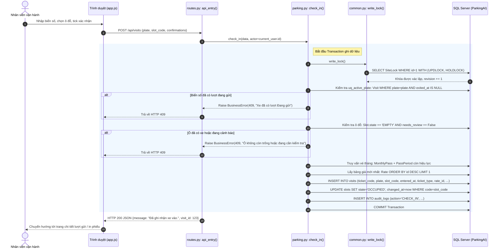
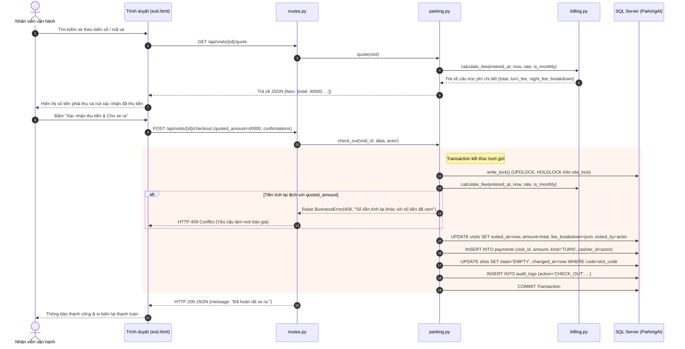
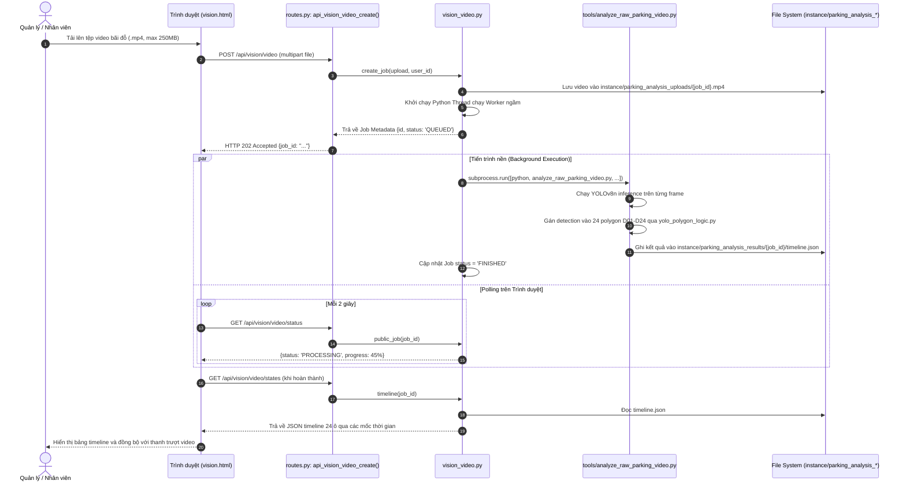
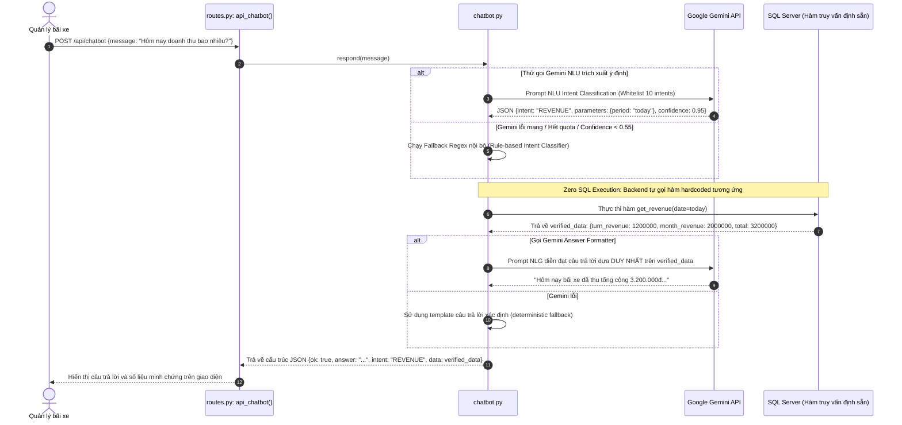

# KIẾN TRÚC VÀ CÁC LUỒNG DỮ LIỆU (ARCHITECTURE AND FLOWS)

> **Dự án:** Hệ thống Quản lý Bãi Đỗ Ô Tô Tích Hợp AI (Parking AI)  
> **Mô hình kiến trúc:** Modular Monolith (Layered Architecture)  
> **Trạng thái:** Đã xác minh qua mã nguồn thực tế  

---

## 1. Sơ đồ Kiến trúc Phân tầng Tổng thể

Hệ thống được tổ chức theo 4 tầng chính: Presentation (Trình diễn), Application & Service (Nghiệp vụ), AI Engine (Thị giác máy tính) và Persistence (Lưu trữ dữ liệu).

```mermaid
graph TB
    subgraph Presentation_Layer ["Presentation Layer (Browser Client)"]
        UI["Web UI: HTML5, Bootstrap 5.3, Jinja2"]
        JS_App["app.js: Fetch API, Event Handling, CSRF Token"]
        ChartJS["Chart.js: Thống kê & Biểu đồ Lưu lượng/Doanh thu"]
        CamCapture["Camera Capture: HTML5 Canvas / MediaStream"]
    end

    subgraph App_Core ["Application Core (Flask WSGI / Waitress - 6 Threads)"]
        AppFactory["app/__init__.py: create_app()"]
        AuthModule["Flask-Login & Session Security"]
        
        subgraph Controllers ["Controllers (routes.py)"]
            WebBP["web Blueprint (Server-Side Rendering)"]
            ApiBP["api Blueprint (/api/* JSON Endpoints)"]
        end

        subgraph Service_Layer ["Service Layer (app/services/)"]
            ParkSvc["parking.py: Check-in, Check-out, Move, Monthly"]
            BillSvc["billing.py: Fee Calculation, Night Block Engine"]
            LayoutSvc["parking_layout.py: Layout Inspector (AB20 vs D24)"]
            ChatSvc["chatbot.py: Intent Router, LLM Sanitizer, Fallback"]
            BackupSvc["backup.py: MS SQL Backup (.bak) & VERIFYONLY"]
            AnalyticsSvc["analytics.py: Historical Capacity, Occupancy Math"]
            CommonSvc["common.py: write_lock(), validators, audit()"]
        end
    end

    subgraph AI_Subsystem ["AI & Computer Vision Engines"]
        subgraph Legacy_CNN ["CNN Module (ai/)"]
            KerasModel["parking_cnn_from_scratch (Keras)"]
            ROICrop["Polygon Crop & Warp (OpenCV)"]
        end

        subgraph Active_YOLO ["Active YOLO Pipeline (app/services/ & tools/)"]
            CarPlateYOLO["Car + Plate Detector YOLO (train_27 + train_30)"]
            YOLOVideoWorker["analyze_raw_parking_video.py (YOLOv8n + Polygons)"]
            TesseractOCR["Tesseract OCR Engine (pytesseract)"]
        end
    end

    subgraph Data_Storage ["Data Persistence Layer"]
        SQLServer[("Microsoft SQL Server (ParkingAI)
        - site_lock: Coarse-grained Pessimistic Lock
        - Filtered Unique Indexes (uq_active_plate, etc.)")]
        LocalDiskWrites[("Local Storage
        - Backups: .bak files
        - Uploads: parking_analysis_uploads/
        - Results: parking_analysis_results/")]
    end

    subgraph External_Cloud ["External Cloud Services"]
        GeminiAPI["Google Gemini API (NLU & NLG Context)"]
    end

    %% Client -> App
    UI --> JS_App
    CamCapture --> JS_App
    JS_App -->|HTTP POST JSON/Multipart with CSRF| ApiBP
    UI -->|HTTP GET Page Views| WebBP

    %% App Core Routing
    WebBP --> Service_Layer
    ApiBP --> Service_Layer
    AppFactory --> AuthModule
    AppFactory --> WebBP
    AppFactory --> ApiBP

    %% Service -> AI Subsystem
    ParkSvc --> CommonSvc
    ParkSvc --> BillSvc
    ParkSvc --> LayoutSvc
    ApiBP -->|POST /api/vision/parking| Legacy_CNN
    ApiBP -->|POST /api/vision/plate| Active_YOLO
    ApiBP -->|POST /api/vision/video| YOLOVideoWorker

    %% Service -> External & DB
    ChatSvc -->|Prompt with Verified Data Whitelist| GeminiAPI
    BackupSvc -->|EXEC BACKUP / RESTORE VERIFYONLY| SQLServer
    BackupSvc -->|Write Binary .bak| LocalDiskWrites
    ParkSvc -->|SELECT site_lock WITH (UPDLOCK, HOLDLOCK)| SQLServer
    AnalyticsSvc -->|Read-only Queries| SQLServer
```

---

## 2. Các Luồng Xử lý Dữ liệu Chính (Detailed Data Flows)

### 2.1. Luồng Xe Vào Bãi (Check-in Flow)
- **Mục đích:** Ghi nhận xe vào bãi an toàn, gán ô đỗ, áp dụng bảng giá hiện hành, ghi nhật ký kiểm toán.
- **Tính chất:** Đồng bộ (Synchronous), Tuần tự hóa giao dịch bằng Khóa bi quan (Pessimistic Lock).



---

### 2.2. Luồng Xe Ra Bãi & Tính Cước (Check-out & Payment Flow)
- **Mục đích:** Tính toán cước phí lũy tiến chính xác theo thời gian thực tế, xác nhận thu tiền mặt và giải phóng ô đỗ.
- **Tính an toàn:** Chống chênh lệch giá (Stale Quote Protection): nếu thời gian xe ra thực tế làm thay đổi số tiền so với lúc xem báo giá (`quote`), giao diện sẽ buộc tải lại báo giá mới.



---

### 2.3. Luồng Phân tích Video Bãi xe Bất đồng bộ (Async Video Analysis Flow)
- **Mục đích:** Xử lý các video bãi xe dài với model YOLOv8n mà không làm đơ hoặc timeout HTTP connection.
- **Kiến trúc:** Background Worker Thread + Polling qua REST API.



---

### 2.4. Luồng Trợ lý Quản trị (AI Chatbot Flow with Zero-SQL Sandbox)
- **Mục đích:** Phân loại câu hỏi tự nhiên tiếng Việt, lấy số liệu bãi xe và trả lời Quản lý mà không cho phép LLM tiếp cận hay thực thi SQL.


