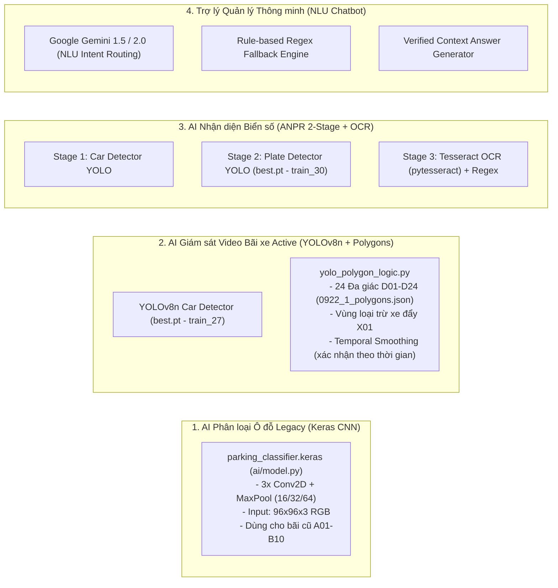

# THAM CHIẾU HỆ THỐNG TRÍ TUỆ NHÂN TẠO VÀ THỊ GIÁC MÁY TÍNH (AI/ML REFERENCE)

> **Dự án:** Hệ thống Quản lý Bãi Đỗ Ô Tô Tích Hợp AI (Parking AI)  
> **Trạng thái:** Đã phân tích và bóc tách từ mã nguồn `ai/`, `app/services/`, `tools/` và thư mục `runs/`  

---

## 1. Bản Đồ Tổng Thể Hệ Thống AI Trong Dự Án

Hệ thống AI không phải là một mô hình đơn lẻ mà bao gồm **4 phân hệ AI độc lập**:

---

## 2. Chi tiết Phân hệ 1: Mô hình Keras CNN (Phân loại Ô đỗ Tĩnh)

- **Vị trí file:** `ai/model.py`, `ai/predict_parking.py`, `app/services/vision.py`.
- **Kiến trúc:** Convolutional Neural Network tuần tự (Sequential) xây dựng từ đầu (from-scratch):
  - `InputLayer`: (96, 96, 3)
  - `Data Augmentation` (chỉ bật khi train): RandomFlip, RandomRotation, RandomZoom, RandomContrast, RandomBrightness.
  - `Rescaling`: $1/255$ (chuẩn hóa giá trị pixel về đoạn $[0, 1]$).
  - Khối 1: `Conv2D(16, kernel=3, padding='same', relu)` + `MaxPooling2D()`.
  - Khối 2: `Conv2D(32, kernel=3, padding='same', relu)` + `MaxPooling2D()`.
  - Khối 3: `Conv2D(64, kernel=3, padding='same', relu)` + `MaxPooling2D()`.
  - `Flatten()` + `Dense(64, relu)` + `Dropout(0.4)` + `Dense(1, sigmoid)`.
- **Đầu ra:** Xác suất ô có xe ($p \in [0, 1]$). Nếu $p \ge 0.5$ thì nhãn là `OCCUPIED`, ngược lại là `EMPTY`.
- **Cơ chế nạp và bảo vệ toàn vẹn (`ai/predict_parking.py:L18-21`):**
  - Mô hình yêu cầu file metadata đi kèm: `parking_classifier.metadata.json`.
  - Kiểm tra băm SHA-256 của file `.keras` với giá trị trong metadata. Nếu không khớp hoặc có cờ `pretrained: true`, hệ thống từ chối nạp mô hình.
- **Trạng thái thực tế:**
  - Bị **vô hiệu hóa tự động** trên cấu hình bãi 24 ô D01–D24 (`app/services/vision.py:L40-45`). Chỉ hoạt động nếu CSDL đang ở layout cũ A01–B10.

---

## 3. Chi tiết Phân hệ 2: Giám sát Video Bãi xe Active (YOLOv8n + Polygons)

- **Vị trí file:** `app/services/vision_video.py`, `tools/analyze_raw_parking_video.py`, `tools/yolo_polygon_logic.py`.
- **Trọng số Model thực tế đã xác minh:**
  - Đường dẫn: `runs/detect/runs/yolo_car_v12/train_27_from_smoke01_best/weights/best.pt` (6.2 MB).
- **Cấu hình Đa giác (Polygons):**
  - Tệp: `config/demo_parking/0922_1_polygons.json` (24 đa giác ô đỗ `D01` đến `D24`).
- **Thuật toán Gán Xe vào Ô đỗ (`tools/yolo_polygon_logic.py`):**
  1. *Loại trừ vật thể giả (`filter_detections_by_exclusion`):* Áp dụng vùng loại trừ đã phê duyệt `X01` (vùng xe đẩy / chốt bảo vệ) để loại bỏ các bounding box không phải ô tô đỗ.
  2. *Hộp lõi xe (`vehicle_core_box`):* Thu nhỏ bounding box của xe để lấy phần thân lõi (loại bỏ bóng đổ hoặc phần nhô ra ngoài ô).
  3. *Tính diện tích giao nhau (Intersection over Slot):* Tính tỷ lệ diện tích giao giữa hộp lõi xe và đa giác ô đỗ. Một xe chỉ được gán duy nhất cho ô đỗ có diện tích giao lớn nhất.
  4. *Xác nhận trạng thái theo thời gian (Temporal State Confirmation):*
     - Không đổi trạng thái ô ngay lập tức sau 1 frame đơn lẻ.
     - Sử dụng lớp `TemporalSlotState`: Bắt buộc trạng thái mới phải duy trì liên tục trong một khoảng khung hình nhất định (Hysteresis / Debounce) mới chính thức chuyển trạng thái từ `EMPTY` sang `OCCUPIED` hoặc ngược lại, loại bỏ hiện tượng nhấp nháy (flickering).

---

## 4. Chi tiết Phân hệ 3: Nhận diện Biển số Xe (Car -> Plate -> OCR)

- **Vị trí file:** `app/services/plate_detection.py`, `app/services/plate_ocr.py`, `tools/detect_car_plates.py`.
- **Quy trình 3 giai đoạn (3-Stage ANPR Pipeline):**
  1. **Stage 1 (Phát hiện ô tô):** Sử dụng YOLO Car Detector (`train_27/weights/best.pt`).
  2. **Stage 2 (Phát hiện biển số):** Cắt vùng đầu/đuôi xe và đưa qua YOLO Plate Detector (`runs/detect/runs/license_plate/train_30/weights/best.pt`, 6.2 MB) để trích xuất chính xác tọa độ biển số xe.
  3. **Stage 3 (Nhận diện ký tự OCR):**
     - Tiền xử lý OpenCV: Resize về chiều rộng chuẩn, chuyển xám (Grayscale), Bilateral Filter khử nhiễu giữ cạnh, Adaptive Thresholding phân ngưỡng nhị phân.
     - Tesseract OCR: Chạy với cấu hình Whitelist chữ hoa và số (`ABCDEFGHIJKLMNOPQRSTUVWXYZ0123456789`), Page Segmentation Mode PSM 7 hoặc PSM 8.
     - Hậu xử lý Regex: Chuẩn hóa theo biển số chuẩn Việt Nam (`^(\d{2})([A-Z]{1,3})(\d{4,6})$`).
- **Nguyên tắc nghiệp vụ (Human-in-the-Loop):**
  - Kết quả OCR chỉ hiển thị dưới dạng **gợi ý (suggestion)**. Nhân viên bắt buộc phải kiểm tra và xác nhận trước khi lưu vào CSDL. Hệ thống luôn hỗ trợ gõ tay nếu OCR đọc sai.

---

## 5. Chi tiết Phân hệ 4: AI Chatbot NLU & Gemini Integration

- **Vị trí file:** `app/services/chatbot.py`.
- **Cơ chế An toàn Tuyệt đối (Zero SQL Execution):**
  - Prompt hệ thống nghiêm cấm LLM sinh câu lệnh SQL hoặc suy đoán số liệu.
  - LLM chỉ được phép trả về JSON chứa `intent` và `parameters`.
- **Danh mục 10 Intent Được Hỗ Trợ (Whitelist):**
  1. `CURRENT_OCCUPANCY`: Tổng quan sức chứa, số chỗ trống/đang đỗ.
  2. `OCCUPIED_SLOTS`: Danh sách các ô đang có xe.
  3. `EMPTY_SLOTS`: Danh sách các ô đang trống.
  4. `SLOT_STATUS`: Tình trạng cụ thể của 1 ô (tham số `slot_code`).
  5. `TODAY_TRAFFIC`: Số lượt xe vào/ra trong ngày.
  6. `REVENUE`: Doanh thu theo ngày.
  7. `PEAK_HOURS`: Khung giờ cao điểm vào/ra.
  8. `MONTHLY_TICKETS`: Tình trạng vé tháng đang hoạt động.
  9. `SYSTEM_HELP`: Hướng dẫn chức năng hệ thống.
  10. `UNKNOWN`: Câu hỏi ngoài phạm vi.
- **Cơ chế Dự phòng (Deterministic Fallback Engine):**
  - Nếu không có Internet, không cấu hình `GEMINI_API_KEY`, API hết hạn ngạch (Quota Exceeded) hoặc điểm tin cậy NLU $< 0.55$: Backend tự động kích hoạt bộ phân loại Regex nội bộ và sinh câu trả lời bằng template có sẵn. Đảm bảo tính sẵn sàng 100% cho bãi xe.

---

## 6. Đánh giá Chất lượng và Giới hạn Đã Xác minh

| Phân hệ AI | Trạng thái mô hình | Độ tin cậy thực tế | Giới hạn đã xác định |
|---|---|---|---|
| **Keras CNN (ai/)** | Chưa có dataset thực tế trong gói gốc; không kèm weights huấn luyện sẵn | **Chưa xác định** chất lượng thực địa | Bị disable trên layout D24. Chỉ là bài tập/mô hình nền tảng. |
| **YOLOv8n Car & Plate** | Đã huấn luyện (train_27, train_30) có trọng số thực tế trong `runs/` | **Đã xác minh** chạy tốt trên video demo đính kèm | Phụ thuộc vào góc camera cố định; chưa kiểm thử trên camera ban đêm có đèn pha rọi ngược. |
| **Tesseract OCR** | Đã tích hợp qua `pytesseract` | **Trung bình** (phụ thuộc độ nét biển số) | Khó đọc biển số bị mờ, cong vênh, bụi bẩn hoặc biển vuông 2 dòng. |
| **Gemini Chatbot** | Hoạt động qua Google GenAI API | **Rất cao** về mặt NLU tiếng Việt; an toàn CSDL tuyệt đối | Cần kết nối Internet ra ngoài để gọi API Google. |
